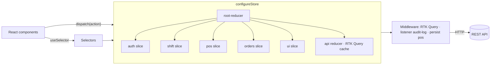

# 05 - State Management

Hai bài tập quản lý state trong React với dữ liệu thật từ [dummyjson.com](https://dummyjson.com):

| Bài | Công cụ | Nội dung |
| :-- | :-- | :-- |
| **1** | Zustand + `persist` | Store giỏ hàng + tuỳ chọn người dùng, tách slice, lưu `localStorage`, có `version` + `migrate` |
| **2** | Redux Toolkit | 1 slice `todos` hoàn chỉnh, giải thích lý do chọn công cụ, phác kiến trúc store theo module |

---

## Cấu trúc thư mục

```text
05-State Management/
├── index.html · package.json · vite.config.js
└── src/
    ├── main.jsx · app.jsx · styles.css          # Tab chuyển giữa 2 bài
    ├── shared/api/dummyjson-client.js           # fetch wrapper dùng chung
    ├── exercise-1-zustand-persist/
    │   ├── store/
    │   │   ├── shop-store.js                    # create + persist (partialize, version, migrate)
    │   │   ├── shop-selectors.js                # selector + formatPrice
    │   │   ├── shop-store.test.js
    │   │   └── slices/
    │   │       ├── cart-slice.js                # giỏ hàng
    │   │       └── preferences-slice.js         # tiền tệ, theme
    │   ├── hooks/use-product-catalog.js         # server state (KHÔNG vào store)
    │   ├── components/                          # product-catalog, cart-summary, preferences-bar
    │   └── zustand-shop-demo.jsx
    └── exercise-2-redux-toolkit/
        ├── store/
        │   ├── app-store.js                     # configureStore (factory cho test)
        │   └── root-reducer.js                  # nơi đăng ký các feature module
        ├── features/todos/
        │   ├── todos-slice.js                   # slice hoàn chỉnh
        │   ├── todos-slice.test.js
        │   └── todos-panel.jsx
        └── redux-todos-demo.jsx
```

## Cách chạy

```bash
cd "05-State Management"
npm install
npm run dev     # http://localhost:5173
npm test        # 13 unit test cho slice/selector/migrate
npm run build
```

---

## Bài 1 — Zustand store có persist, tách slice

**Dữ liệu thật quản lý:** giỏ hàng các sản phẩm lấy từ `GET /products`.

### Tách slice — vì sao chia như vậy?

| Slice | State | Lý do tách |
| :-- | :-- | :-- |
| `cart-slice` | `cartItems` (map `id → item`) + add/update/remove/clear | Logic nghiệp vụ, thay đổi liên tục |
| `preferences-slice` | `currency`, `theme` | Vòng đời khác: `clearCart()` không được xoá tuỳ chọn người dùng |

- Danh sách sản phẩm là **server state** → để ở hook riêng, không bỏ vào store (bài 06 dùng TanStack Query cho phần này).
- `cartItems` dạng map thay vì mảng: thêm/sửa/xoá O(1), không bao giờ trùng sản phẩm.
- Chỉ lưu field cần thiết (`id, title, price, thumbnail, quantity`) → localStorage gọn.

### Persist

```js
persist(createShopState, {
  name: 'shop-store',
  version: 2,
  storage: createJSONStorage(() => localStorage),
  partialize: (s) => ({ cartItems: s.cartItems, currency: s.currency, theme: s.theme }),
  migrate: migrateShopState, // v1 (cart: []) → v2 (cartItems: {})
})
```

- `partialize`: chỉ lưu data, không lưu action.
- `version` + `migrate`: đổi cấu trúc state mà người dùng cũ không bị mất giỏ hàng.

**Kiểm tra:** thêm vài sản phẩm, đổi VND / Dark → F5 → state vẫn còn. DevTools → Application → Local Storage → key `shop-store`.

### Lưu ý re-render (Zustand v5)

- Mỗi `ProductCard` chỉ subscribe `selectQuantityOf(id)` → thêm 1 sản phẩm chỉ card đó re-render.
- Selector trả mảng/object mới (`Object.values(...)`) phải bọc `useShallow`, nếu không sẽ lặp render vô hạn.

---

## Bài 2 — Redux Toolkit: 1 slice hoàn chỉnh

`features/todos/todos-slice.js` gồm đủ các thành phần của 1 slice production:

| Thành phần | Dùng để |
| :-- | :-- |
| `createEntityAdapter` | Chuẩn hoá `{ ids, entities }`, CRUD + selector có sẵn, `sortComparer` |
| `createAsyncThunk` + `condition` | Gọi `GET /todos`, chặn request trùng khi đang `loading` (StrictMode/double click) |
| `extraReducers` | Xử lý `pending / fulfilled / rejected` (bỏ qua khi bị abort) |
| `prepare` callback | Sinh `id` bằng `nanoid`, `trim` input trước khi vào reducer |
| Immer | Viết "mutate" (`todo.completed = !todo.completed`) nhưng vẫn immutable |
| `createSelector` | `selectVisibleTodos`, `selectTodoStats` được memo hoá |

### Giải thích lý do chọn công cụ — dự án giả định

> **Dự án:** *Hệ thống quản lý chuỗi cửa hàng (POS + Admin dashboard)* — 8–10 FE dev, 3 team, nhiều màn hình chia sẻ state (phiên đăng nhập, ca làm việc, giỏ hàng POS, phân quyền), cần audit được thao tác của nhân viên, dự án sống 3–5 năm.

| Tiêu chí | Redux Toolkit | Zustand | Context + useReducer |
| :-- | :-- | :-- | :-- |
| Quy ước chung cho team lớn | ✅ Slice/thunk/selector cố định | ⚠️ Tự do, mỗi người 1 kiểu | ❌ |
| DevTools, time-travel, log action | ✅ Có sẵn | ⚠️ Qua middleware | ❌ |
| Middleware (audit log, analytics, sync) | ✅ Listener middleware | ⚠️ Tự viết | ❌ |
| Server state / cache | ✅ RTK Query cùng hệ sinh thái | ➖ Kết hợp TanStack Query | ❌ |
| Boilerplate | ⚠️ Nhiều hơn | ✅ Rất ít | ✅ Ít |
| Hiệu năng re-render | ✅ Selector | ✅ Selector | ❌ Re-render toàn bộ consumer |

**Kết luận:** chọn **Redux Toolkit** cho dự án này vì team đông và dự án dài hạn cần *quy ước thống nhất*, cần *log/audit từng action* của nhân viên (mỗi action là 1 object serializable → dễ ghi log), và có RTK Query cho server state trong cùng 1 hệ sinh thái.

**Khi nào chọn khác:** app nhỏ / team 1–3 người / chỉ vài state UI (như bài 1) → **Zustand** gọn hơn nhiều. Dữ liệu chủ yếu từ API → **TanStack Query** + một store nhỏ cho client state. Context chỉ nên dùng cho giá trị ít thay đổi (theme, locale).

### Phác kiến trúc store theo module

Mỗi feature là 1 module tự đóng gói; store chỉ biết đến module qua `root-reducer.js`.

```text
src/
├── app/
│   ├── store.js              # configureStore: reducer + middleware + devTools
│   └── root-reducer.js       # combineReducers({ auth, shift, pos, catalog, orders, ui })
├── services/
│   └── api.js                # RTK Query createApi — server state (products, orders, reports)
└── features/
    ├── auth/                 # auth-slice.js · auth-selectors.js · auth-thunks.js
    ├── shift/                # ca làm việc của thu ngân
    ├── pos/                  # giỏ hàng tại quầy (client state, persist)
    ├── orders/               # trạng thái lọc/chọn đơn — dữ liệu đơn lấy từ RTK Query
    └── ui/                   # sidebar, modal, toast
```



**Quy tắc module:**
1. Component chỉ import từ `features/<module>/index` (public API), không import sâu vào file nội bộ module khác.
2. Server state (danh sách sản phẩm, đơn hàng) → RTK Query, **không** copy vào slice.
3. Logic chéo module (vd: đăng xuất → reset `pos`, `shift`) dùng `extraReducers` lắng nghe `auth/loggedOut` hoặc listener middleware — không gọi chéo trực tiếp.
4. Chỉ persist slice cần thiết (`pos`, `ui`), không persist `auth` token vào localStorage.

Bài 2 hiện thực phần lõi của kiến trúc này: `store/app-store.js` + `store/root-reducer.js` + module `features/todos/`.
