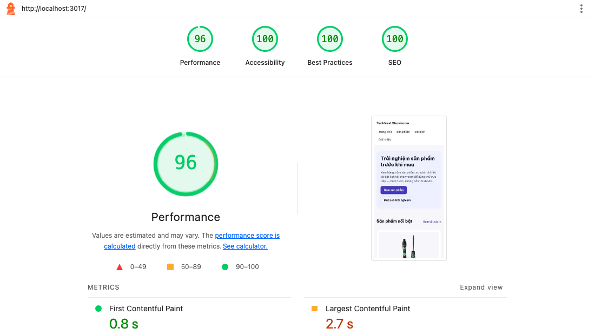

# 07 - Next.js App Router & Form Handling

Gộp 2 bài vào 1 dự án **TechNest Showroom** (Next.js 16 App Router + TypeScript): 4 trang nội dung + form **đặt lịch trải nghiệm** nhiều bước (React Hook Form + Zod). Dữ liệu sản phẩm thật từ [dummyjson.com](https://dummyjson.com).

| Yêu cầu | Đã làm |
| :-- | :-- |
| Route `/`, `/products`, `/products/[id]`, `/about` | ✅ + `/booking` (form) |
| Layout chung + `loading.tsx` cho danh sách | ✅ [`app/layout.tsx`](src/app/layout.tsx), [`app/products/loading.tsx`](src/app/products/loading.tsx) |
| 1 Client Component ở "phần lá" | ✅ [`FavoriteButton`](src/components/favorite-button.tsx) — chỉ nút ♡ là client, card/trang vẫn là Server Component |
| Chọn đúng SSG / ISR / SSR + ghi chú | ✅ comment ở đầu mỗi `page.tsx` + bảng bên dưới |
| Metadata SEO (title / description / OpenGraph) | ✅ title template, `generateMetadata` theo sản phẩm, ảnh OG sinh bằng `next/og` |
| `next/image` + `next/font` + Lighthouse | ✅ Be Vietnam Pro (subset `vietnamese`), ảnh AVIF/WebP — xem [lighthouse/](lighthouse) |
| Form nhiều bước + Zod đầy đủ | ✅ 3 bước, schema dùng chung client + Server Action |
| Lỗi inline tiếng Việt, `mode: 'onBlur'` | ✅ |
| Giữ dữ liệu khi quay lại, submit ở bước cuối | ✅ 1 form instance + nháp `sessionStorage` |
| ≥ 5 edge case | ✅ 14 edge case, 21 unit test + test tay trên trình duyệt |

---

## Cấu trúc

```text
07-NextJS Form Handling/
├── next.config.ts                 # remotePatterns cho next/image
├── lighthouse/                    # báo cáo HTML + ảnh chụp điểm
└── src/
    ├── app/
    │   ├── layout.tsx             # layout chung, next/font, metadata gốc
    │   ├── page.tsx               # /            SSG
    │   ├── about/page.tsx         # /about       SSG (force-static)
    │   ├── products/
    │   │   ├── page.tsx           # /products    ISR 1h
    │   │   ├── loading.tsx        # skeleton khi tải danh sách
    │   │   └── [id]/page.tsx      # /products/1  ISR + generateStaticParams
    │   ├── booking/page.tsx       # /booking     SSR (đọc ?product=)
    │   ├── not-found.tsx · opengraph-image.tsx · icon.svg · globals.css
    ├── components/
    │   ├── product-card.tsx       # Server Component
    │   └── favorite-button.tsx    # 'use client' — leaf
    ├── lib/                       # products-api.ts (fetch + revalidate), site-config.ts, format-price.ts
    └── features/booking/
        ├── booking-schema.ts      # Zod: 3 schema bước + schema đầy đủ (intersection)
        ├── booking-schema.test.ts # 21 test edge case
        ├── vietnam-date-utils.ts  # "hôm nay" theo Asia/Ho_Chi_Minh
        ├── submit-booking-action.ts   # 'use server' — validate lại bằng cùng schema
        ├── use-booking-draft.ts   # lưu / khôi phục nháp sessionStorage
        ├── booking-form-types.ts
        └── components/            # booking-form (điều phối), 3 step, form-field, booking-success
```

## Chạy

```bash
cd "07-NextJS Form Handling"
npm install
npm run dev        # http://localhost:3000
npm test           # 21 unit test schema
npm run lint && npm run typecheck
npm run build && npm start
```

---

## 1. Chiến lược render từng trang

Kết quả `next build` (○ Static · ● SSG có generateStaticParams · ƒ Dynamic):

```text
┌ ○ /                          ← SSG
├ ○ /about                     ← SSG
├ ƒ /booking                   ← SSR
├ ○ /products                  1h   ← ISR
└   /products/[id]
  ├ ● /products/1              1h   ← ISR, build sẵn 12 trang
  └ ● [+11 more paths]
```

| Route | Chiến lược | Vì sao |
| :-- | :-- | :-- |
| `/` | **SSG** (`revalidate = false`, fetch cũng `revalidate: false`) | Nội dung marketing + 4 sản phẩm nổi bật, chỉ đổi khi deploy. Lưu ý: revalidate của trang = giá trị **nhỏ nhất** giữa route và các fetch, nên fetch cũng phải `false`, nếu không trang tự thành ISR. |
| `/about` | **SSG** (`dynamic = 'force-static'`) | Không có dữ liệu động. `force-static` để build báo lỗi nếu ai đó lỡ dùng API động. |
| `/products` | **ISR** (`revalidate = 3600`) | Giá / tồn kho đổi định kỳ. Người dùng luôn nhận HTML tĩnh từ CDN; quá 1 giờ thì request kế tiếp kích hoạt render lại ở nền. Vẫn tốt cho SEO. |
| `/products/[id]` | **ISR + `generateStaticParams`** | Build sẵn 12 sản phẩm hot. Sản phẩm khác (`dynamicParams = true`) render lần đầu khi có người xem rồi cache lại. id sai → `notFound()` (404). |
| `/booking` | **SSR** (dynamic) | Đọc `searchParams` (`?product=5` từ nút "Đặt lịch" ở trang chi tiết) để điền sẵn sản phẩm nên phải render theo từng request. Danh sách sản phẩm bên trong vẫn lấy từ Data Cache, không gọi API mỗi lần. |

Không dùng **CSR thuần** cho trang nào: chỉ `FavoriteButton` (đọc `localStorage`) và form là client.

---

## 2. SEO, next/image, next/font, Lighthouse

- **Metadata:** `title.template = '%s | TechNest Showroom'`, `description`, `canonical` riêng từng trang, OpenGraph (`og:title/description/url/image`, `locale vi_VN`), Twitter card. Trang chi tiết dùng `generateMetadata` → title + ảnh OG là ảnh sản phẩm. Ảnh OG mặc định 1200×630 sinh lúc build bằng `app/opengraph-image.tsx`.
- **next/font:** `Be_Vietnam_Pro` subset `latin` + `vietnamese`, `display: swap` → font tự host, không request Google Fonts lúc chạy, CLS = 0.
- **next/image:** `sizes` theo layout, `preload` cho ảnh trong màn hình đầu (LCP), còn lại lazy-load; định dạng AVIF/WebP.

**Lighthouse** (bản `next build && next start`, mobile throttling mặc định, Lighthouse 13.6):

| Trang | Performance | Accessibility | Best Practices | SEO | LCP | CLS |
| :-- | :-: | :-: | :-: | :-: | :-: | :-: |
| `/` | 96 | 100 | 100 | 100 | 2.7 s | 0 |
| `/products` | 97 | 100 | 100 | 100 | 2.6 s | 0 |
| `/products/1` | 97 | 100 | 100 | 100 | 2.5 s | 0 |
| `/booking` | 100 | 100 | 100 | 100 | 0.6 s | 0 |



Ảnh chụp và báo cáo HTML đầy đủ của từng trang nằm trong [`lighthouse/`](lighthouse). Lần chạy đầu bị trừ điểm vì 2 lỗi, đã sửa: heading `/products` nhảy h1 → h3 (thêm prop `headingLevel`) và thiếu favicon gây 404 trong console (thêm `app/icon.svg`).

---

## 3. Form đặt lịch nhiều bước

**Bước 1** Thông tin liên hệ → **Bước 2** Chi tiết lịch hẹn → **Bước 3** Xem lại + đồng ý điều khoản → **Submit**.

Thiết kế chính:

- **Một** `useForm` cho cả 3 bước, các bước render có điều kiện. RHF giữ giá trị field đã unmount (`shouldUnregister: false` mặc định) nên **quay lại bước trước không mất dữ liệu**.
- **Resolver theo bước:** chỉ validate schema của bước hiện tại → field bước sau chưa nhập không báo lỗi sớm. Nút "Tiếp tục" gọi `trigger(fieldsOfStep)`.
- **`mode: 'onBlur'`:** báo lỗi khi rời field, không làm phiền lúc đang gõ; `reValidateMode: 'onChange'` → đã có lỗi thì sửa tới đâu cập nhật tới đó.
- **Submit chỉ ở bước cuối:** validate lại **toàn bộ** bằng `bookingSchema` (phòng nháp cũ), lỗi ở bước nào thì nhảy về bước đó. Sau đó gửi **Server Action** và server validate lại bằng **cùng schema**.
- **Nháp `sessionStorage`:** F5 / rời trang rồi Back vẫn còn dữ liệu. Không lưu ô "đồng ý điều khoản". Submit thành công thì xoá nháp.
- **A11y:** `aria-invalid`, `aria-describedby` trỏ tới hint/lỗi, lỗi có `role="alert"`, đổi bước thì focus về tiêu đề bước.

### Edge case đã liệt kê & thử

| # | Edge case | Kết quả mong đợi | Cách thử |
| :-- | :-- | :-- | :-- |
| 1 | Họ tên chỉ toàn khoảng trắng | Trim → "Họ tên phải có ít nhất 2 ký tự" | Unit test + trình duyệt ✅ |
| 2 | Họ tên tiếng Việt có dấu / chứa số, thẻ HTML | "Nguyễn Thị Ánh" hợp lệ; "Anh123 \<b\>" → "chỉ gồm chữ cái" | Unit test ✅ |
| 3 | Email `"  Anh@Example.COM "` | Trim + lowercase → `anh@example.com` | Unit test + trình duyệt ✅ |
| 4 | SĐT `+84 912.345.678` / đầu số `01x` / thiếu số | Bỏ ký tự phân cách → hợp lệ; còn lại báo "không hợp lệ" | Unit test + trình duyệt ✅ |
| 5 | Ngày quá khứ / Chủ nhật / quá 60 ngày / `2026-02-30` / để trống | Mỗi trường hợp 1 thông báo riêng | Unit test ✅ |
| 6 | Hẹn **hôm nay** nhưng khung giờ đã qua / còn < 60 phút | Lỗi liên field gắn vào ô "Khung giờ" | Unit test + trình duyệt ✅ |
| 7 | Server chạy UTC, người dùng ở UTC+7 (lệch ngày) | "Hôm nay" luôn tính theo `Asia/Ho_Chi_Minh` | Unit test (giả lập 23:30 UTC) ✅ |
| 8 | Số người trống (NaN) / 0 / 6 / 2.5 | "Vui lòng nhập số người", "Tối thiểu 1", "Tối đa 5", "số nguyên" | Unit test + trình duyệt ✅ |
| 9 | Ghi chú > 300 ký tự / chứa `<script>` | Báo lỗi độ dài; HTML hiển thị dạng text (React escape) | Unit test + trình duyệt ✅ |
| 10 | Nhấn **Enter** ở bước 1–2 | Không submit sớm, validate rồi sang bước kế | Trình duyệt ✅ |
| 11 | Quay lại bước trước / **F5** giữa chừng | Dữ liệu còn nguyên; F5 khôi phục từ nháp | Trình duyệt ✅ |
| 12 | Chưa tick điều khoản | "Bạn cần đồng ý với điều khoản đặt lịch" | Unit test + trình duyệt ✅ |
| 13 | **Double-click** nút xác nhận | Nút khoá khi `isSubmitting` → chỉ 1 POST | Trình duyệt (Network: 1 POST) ✅ |
| 14 | Gọi Server Action trực tiếp với payload sai / `?product=99999` / `?product=1&product=2` | Server từ chối với đủ lỗi; id không tồn tại → cảnh báo, không crash; nhiều giá trị → lấy giá trị đầu | Unit test + curl ✅ |

---

## 4. Build & Deploy

```bash
npm run lint && npm run typecheck && npm test && npm run build   # tất cả đều pass
```

**Deploy lên Vercel** (Root Directory là thư mục con của repo):

1. Vào [vercel.com/new](https://vercel.com/new) → Import repo `junior-web-repo`.
2. **Root Directory:** `07-NextJS Form Handling` · Framework: Next.js (tự nhận) → Deploy.
3. Vercel tự cấp `VERCEL_PROJECT_PRODUCTION_URL` → `metadataBase`, canonical và OpenGraph tự dùng domain thật.

Hoặc dùng CLI: `npx vercel login` rồi `npx vercel --prod --cwd "07-NextJS Form Handling"`.

**Link deploy:** _(cập nhật sau khi deploy)_
